<div align="center">
<br>


<br>

[](#)
[-6A1B9A?style=for-the-badge&logo=academia&logoColor=white)](#)
[](https://www.cs.toronto.edu/~kriz/cifar.html)
[](#-results-summary)

<br>


</div>

<br>

## 🎬 Video Walkthrough

<div align="center">

[](https://drive.google.com/file/d/1fgX632JjCGQxfwgIektDRZ9JJoMLFZW5/view?usp=sharing)


🎥 **A complete video explanation (face + screen, 5–10 min)** covering the complete project workflow, including loading CIFAR-10 from the local batch files, normalisation and one-hot labels, manual convolution, padding and strides, pooling and flatten, LeNet-5 and the custom CNN, training with EarlyStopping and ReduceLROnPlateau, confusion-matrix analysis, data augmentation, MobileNetV2 feature extraction and fine-tuning, the residual connection, and the final model comparison.


> 📌 *Click the button above or [open the video directly →](https://drive.google.com/file/d/1fgX632JjCGQxfwgIektDRZ9JJoMLFZW5/view?usp=sharing)*

</div>

---

## 🎯 About This Project

> A cat and a dog are both furry, four-legged and about the same size in a 32×32 picture. A model has to learn the small details that separate them — and that is exactly where a small CNN struggles the most.

This project builds an image classifier on **CIFAR-10** — **60,000 colour images** in 10 classes — and uses it to answer two questions: **how far can a small CNN trained from scratch go, and what do data augmentation and transfer learning add?** It starts by comparing the parameter count of an ANN and a CNN, performs a convolution by hand with SciPy, checks padding and stride output sizes, builds **LeNet-5** and a **175,018-parameter custom CNN**, then adds **data augmentation** (two ways) and **MobileNetV2 transfer learning** (feature extraction and fine-tuning). All six models are compared at the end.

<div align="center">

```
░░░░░░░░░░░░░░░░░░░░░░░░░░░░░░░░░░░░░░░░░░░░░░░░░░░░░░░░░░░
   60,000 Images → Normalise (÷ max pixel) → One-hot → 45K / 5K / 10K split
   ───────────────────────────────────────────────────────
   LeNet-5 → Custom CNN → CNN + Augmentation (2 ways)
   ───────────────────────────────────────────────────────
   MobileNetV2 Feature Extraction → Fine-Tuning → Residual Block
   ───────────────────────────────────────────────────────
   Manual Convolution → Padding & Strides → Pooling → Comparison
░░░░░░░░░░░░░░░░░░░░░░░░░░░░░░░░░░░░░░░░░░░░░░░░░░░░░░░░░░░
```

</div>

<br>

---

## 📚 Dataset

| Item | Detail |
|:---|:---|
| **Name** | CIFAR-10 |
| **Source** | [cs.toronto.edu/~kriz/cifar.html](https://www.cs.toronto.edu/~kriz/cifar.html) (Python version) |
| **Files** | `cifar-10-batches-py/` — `data_batch_1` to `data_batch_5`, `test_batch`, `batches.meta` |
| **Size** | 60,000 colour images, 32 × 32 × 3 — 6,000 per class |
| **Classes (10)** | airplane, automobile, bird, cat, deer, dog, frog, horse, ship, truck |
| **Official split** | 50,000 train (5,000 per class) / 10,000 test (1,000 per class) |
| **Split used** | 45,000 train / 5,000 validation (last 10% of the training images) / 10,000 test |
| **Licence** | Free for research and educational use |

**Citation**

> Krizhevsky, A. (2009). *Learning Multiple Layers of Features from Tiny Images.* Technical Report, University of Toronto.

> ⚠️ The dataset is **not** included in this repository. Download the Python version from the link above and extract it so that the folder `cifar-10-batches-py/` sits next to the notebook. `keras.datasets.cifar10.load_data()` is deliberately **not** used — the notebook reads the batch files directly with a small `load_batch()` function. Keras downloads the MobileNetV2 ImageNet weights on first use, so an internet connection is needed once.

<div align="center">

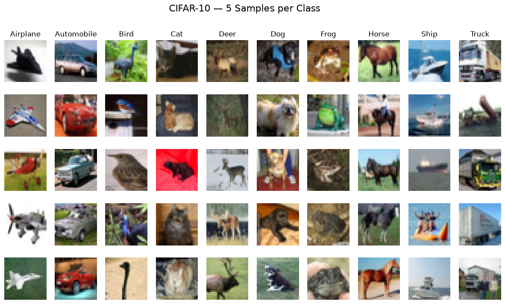

*Five training images from each of the 10 classes. At 32 × 32 pixels, similar classes such as cat and dog are hard to tell apart.*

</div>

<br>

---

## ✨ What Makes This Project Stand Out

<table>
<tr>
<td width="50%" valign="top">

### 🧼 Clean Data Pipeline
- Official batch files read directly and reshaped from `(N, 3072)` to `(N, 32, 32, 3)`
- Maximum pixel value (255) read from the data and used to normalise — verified min `0.0`, max `1.0`
- Validation set cut from the training images only; the 10,000 test images are used only for final scores
- Input shape and number of classes are read from the data, not typed in

</td>
<td width="50%" valign="top">

### 🧮 Built by Hand, Then Verified
- Edge-detection convolution written with SciPy: `32 × 32 → 30 × 30`
- Padding and stride output sizes matched the formula `(32 − 3) / 1 + 1 = 30` and Keras
- LeNet-5 convolution parameters counted by hand (**456** and **2,416**) — both matched Keras
- Dense vs Conv2D with 8 units: **24,584** vs **224** parameters

</td>
</tr>
<tr>
<td width="50%" valign="top">

### 🔍 Honest Reporting
- Same optimiser, loss, EarlyStopping and ReduceLROnPlateau for all four from-scratch models
- Test set never used for tuning or stopping
- Results reported as measured, including surprises: the **Keras augmentation layers did not beat the no-augmentation model**, and **MobileNetV2 overfits strongly**

</td>
<td width="50%" valign="top">

### 🚀 Transfer Learning, Step by Step
- Images resized to 96 × 96 in batches with `tf.data` (no 5 GB array in memory)
- A `Rescaling` layer maps 0–1 pixels to the −1…1 range MobileNetV2 expects
- Feature extraction first (**165,258** trainable parameters), then fine-tuning the last 30 base layers (**1,691,658** trainable)
- Learning rate lowered from `1e-3` to `1e-5` for fine-tuning

</td>
</tr>
</table>

<br>

---

## 🗺️ Full Project Journey

<div align="center">

| Task | Focus | Key Output |
|:---:|:---|:---|
| 🧹 **Task A1** | Data loading, EDA & preprocessing | Sample grid · pixel histograms · normalisation · one-hot labels · train/validation split · MLP vs CNN parameters |
| 🔲 **Task A2** | Convolution, padding & strides | Manual edge convolution · VALID vs SAME shapes · stride table · feature maps |
| 🏊 **Task A3** | Pooling, Flatten & architecture | Max vs Average pooling · Flatten · LeNet-5 (62,006 params) · custom CNN (175,018 params) |
| 🏋️ **Task A4** | Training the CNN | EarlyStopping + ReduceLROnPlateau · training curves · confusion matrix · misclassified images · saved `.h5` model |
| 🔄 **Task A5** | Data augmentation | `ImageDataGenerator` · augmentation grid · with vs without · Keras augmentation layers |
| 🚀 **Task A6** | Transfer learning | MobileNetV2 feature extraction · fine-tuning · results table · residual block |

</div>

<br>

---

## 🧼 Preprocessing Summary

| Step | What was done | Why |
|:---|:---|:---|
| 1. Load | Read the 5 training batches and the test batch with `pickle`; reshape `(N, 3072)` → `(N, 3, 32, 32)` → `(N, 32, 32, 3)` | CIFAR stores channels first; plotting and `Conv2D` need channels last |
| 2. Check | Shapes `(50000, 32, 32, 3)` and `(10000, 32, 32, 3)`, labels 0–9, dtype `uint8` | Confirms the manual loader works |
| 3. Normalise | Divide by the maximum pixel value (255) → values 0 to 1 | Small inputs make training faster and more stable |
| 4. One-hot labels | 10 columns, one per class | Needed for categorical cross-entropy |
| 5. Split | First 45,000 images for training, last 5,000 (10%) for validation | Validation drives EarlyStopping and learning-rate reduction; the test set stays untouched |
| 6. Resize *(transfer learning only)* | 96 × 96 through `tf.data`, then `Rescaling` to −1…1 | MobileNetV2 needs a larger input and its own pixel range |

Final shapes: `X_tr (45000, 32, 32, 3)`, `X_val (5000, 32, 32, 3)`, `X_test (10000, 32, 32, 3)`; one-hot labels have 10 columns.

<div align="center">
<table>
<tr>
<td align="center" width="50%">

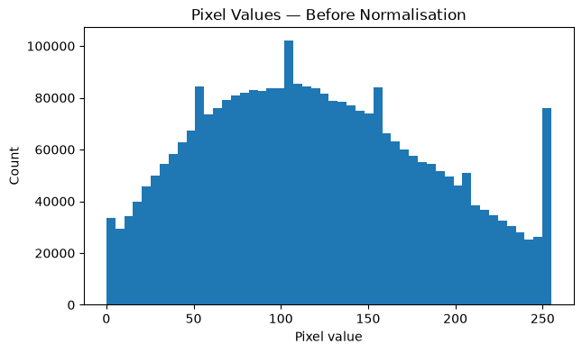

*Before: pixel values run from 0 to 255.*

</td>
<td align="center" width="50%">


*After: the same shape, rescaled to 0–1.*

</td>
</tr>
</table>
</div>

<br>

---

## 🧠 Convolution, Padding and Pooling in One Paragraph Each

### 🔲 Convolution
A `Conv2D` layer slides a small filter over the image and computes one value for each patch. The **same filter weights** are reused at every position, so the parameter count is `(kernel height × kernel width × input channels + 1) × filters` — **456** for the first LeNet-5 layer and **2,416** for the second, both matching Keras. For 8 outputs, a Dense layer on the flattened image needs **24,584** parameters, while a 3 × 3 `Conv2D` with 8 filters needs only **224** (about 110× fewer) and keeps the position of pixels.

<div align="center">

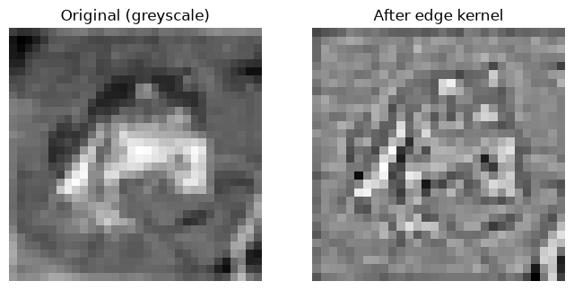

*The manual edge-detection kernel keeps the edges and removes flat areas. With no padding, the output shrinks from 32 × 32 to 30 × 30.*

</div>

### 📐 Padding and Strides
**VALID** padding adds nothing, so the output shrinks; **SAME** padding adds a border of zeros so the output keeps the input size. A bigger stride makes the output smaller. Output sizes for a 3 × 3 kernel on a 32 × 32 image (all matched Keras):

<div align="center">

| Padding | Stride 1 | Stride 2 |
|:---:|:---:|:---:|
| **VALID** | 30 × 30 | 15 × 15 |
| **SAME** | 32 × 32 | 16 × 16 |

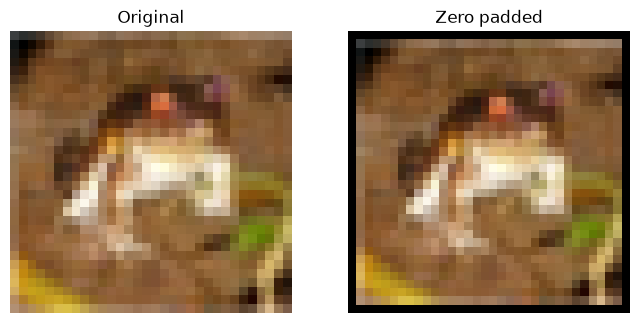

*Zero padding adds a border (32 × 32 → 34 × 34) so the kernel can also cover the edge pixels.*

</div>

### 🏊 Pooling and Flatten
Pooling makes feature maps smaller. Here 16 feature maps of 32 × 32 became 16 × 16 after a 2 × 2 pool, and `Flatten` turned them into one vector of **4,096** values for the Dense layers. **MaxPooling** keeps the strongest value in each window, so maps look sharper; **AveragePooling** keeps the mean, so maps look smoother.

<div align="center">
<table>
<tr>
<td align="center" width="33%">

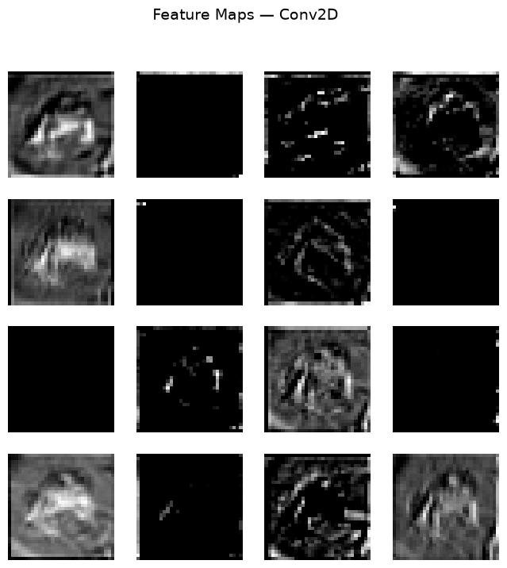

*After Conv2D*

</td>
<td align="center" width="33%">

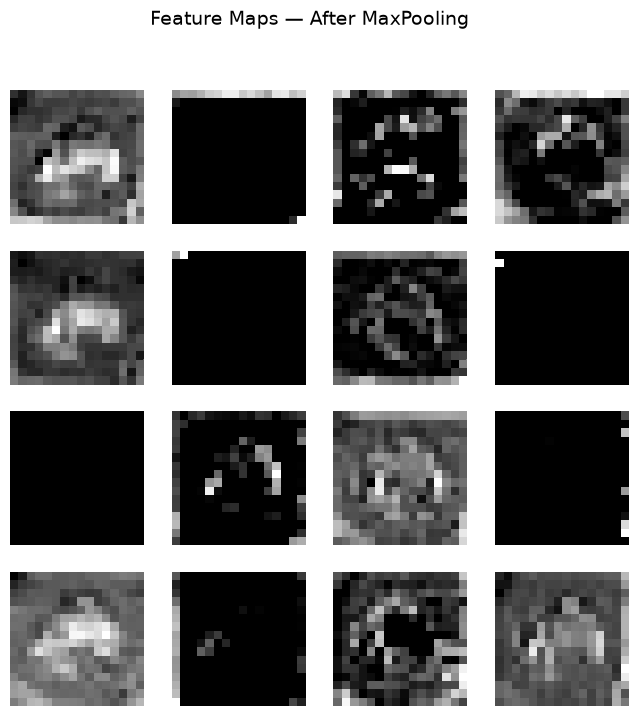

*After MaxPooling*

</td>
<td align="center" width="33%">

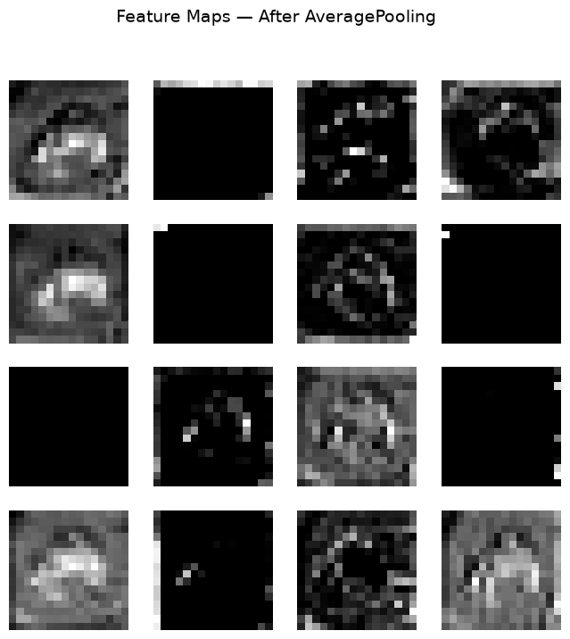

*After AveragePooling*

</td>
</tr>
</table>
</div>

### 🏗️ The Architectures

| Model | Layers | Parameters |
|:---|:---|:---:|
| **LeNet-5** | Conv 6 @ 5×5 (tanh) → AvgPool → Conv 16 @ 5×5 (tanh) → AvgPool → Flatten → Dense 120 → Dense 84 → Dense 10 | 62,006 |
| **Custom CNN** | Conv 32 ×2 → MaxPool → Conv 64 ×2 → MaxPool → Conv 128 → GlobalAveragePooling → Dense 256 → Dense 10 (ReLU, SAME padding) | 175,018 |
| **Residual block** | 1×1 shortcut Conv + two 3×3 Conv 64 → Add → ReLU | 38,976 |

The custom CNN uses `GlobalAveragePooling2D` instead of `Flatten`, which keeps it far below the 2-million-parameter limit.

<br>

---

## 🏋️ Training Curves

<div align="center">

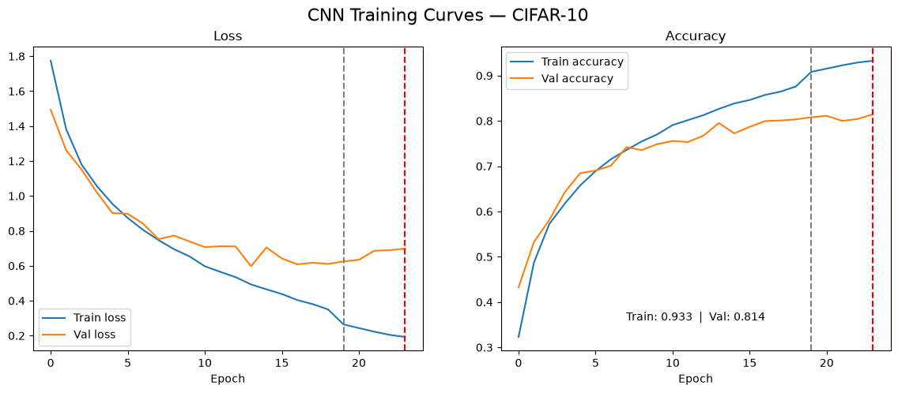

*Custom CNN (no augmentation): Adam, batch size 64, EarlyStopping (patience 10, best weights restored) and ReduceLROnPlateau (factor 0.5, patience 5). The grey dashed line marks the learning-rate reduction and the red dashed line marks where EarlyStopping stopped training.*

</div>

- **Custom CNN** stopped after 24 epochs; the lowest validation loss came at epoch 14 and the learning rate was halved after epoch 19. Final train accuracy was 0.933 against 0.814 on validation, and the validation loss rose after about epoch 14 — a clear sign of **overfitting**.
- **LeNet-5** also stopped after 24 epochs, with train accuracy 0.744 against only 0.554 on validation.
- **CNN with ImageDataGenerator** trained much longer (44 epochs, best validation loss at epoch 34) with the learning rate halved after epochs 19, 30 and 39. Its final train–validation gap was **0.041**, against **0.118** without augmentation.
- **CNN with Keras augmentation layers** trained for 52 epochs (best validation loss at epoch 42) and ended with train accuracy 0.833 against 0.811 on validation.

<br>

---

## 📈 Results Summary

<div align="center">

| Model | Parameters | Time / Epoch (s) | Epochs | Train Acc | Val Acc | Test Accuracy |
|:---|:---:|:---:|:---:|:---:|:---:|:---:|
| LeNet-5 | 62,006 | ≈ 2 | 24 | 0.7438 | 0.5542 | 0.5476 |
| Custom CNN (no augmentation) | 175,018 | ≈ 14 | 24 | 0.9327 | 0.8144 | 0.7879 |
| CNN + ImageDataGenerator | 175,018 | ≈ 17 | 44 | 0.8769 | 0.8364 | 0.8284 |
| CNN + Keras augmentation layers | 175,018 | ≈ 16 | 52 | 0.8327 | 0.8110 | 0.7843 |
| MobileNetV2 feature extraction | 2,423,242 | ≈ 40 | 20 | 0.9916 | 0.8640 | 0.8530 |
| **MobileNetV2 fine-tuned** | **2,423,242** | ≈ 64 | 10 *(after the first 20)* | **0.9983** | **0.8800** | **0.8726** |

*Train and validation accuracy are last-epoch values from the Keras log. For the four from-scratch models the weights with the lowest validation loss were restored by EarlyStopping before testing, so their test accuracy can differ slightly from the last-epoch values. Times are rounded from the Keras logs on the author's machine. Test set: 10,000 images.*

</div>

**What the table shows**
- **The fine-tuned MobileNetV2 ranks first** (0.8726), 1.96 points above feature extraction alone — but it has 2.4 million parameters (about 14× the custom CNN) and needs about 64 s per epoch.
- **The augmented custom CNN is within 4.4 points** of the fine-tuned model (0.8284 vs 0.8726) with about 14× fewer parameters.
- **ImageDataGenerator added 4.05 points** over the no-augmentation CNN (0.8284 vs 0.7879) and cut the train–validation gap from 0.118 to 0.041.
- **The Keras augmentation layers gave no gain** (0.7843, 0.36 points *below* the no-augmentation model) and were 4.4 points below ImageDataGenerator.
- **LeNet-5 was the weakest model** by a wide margin (0.5476).

### Confusion Matrix and Misclassified Images

<div align="center">
<table>
<tr>
<td align="center" width="50%">

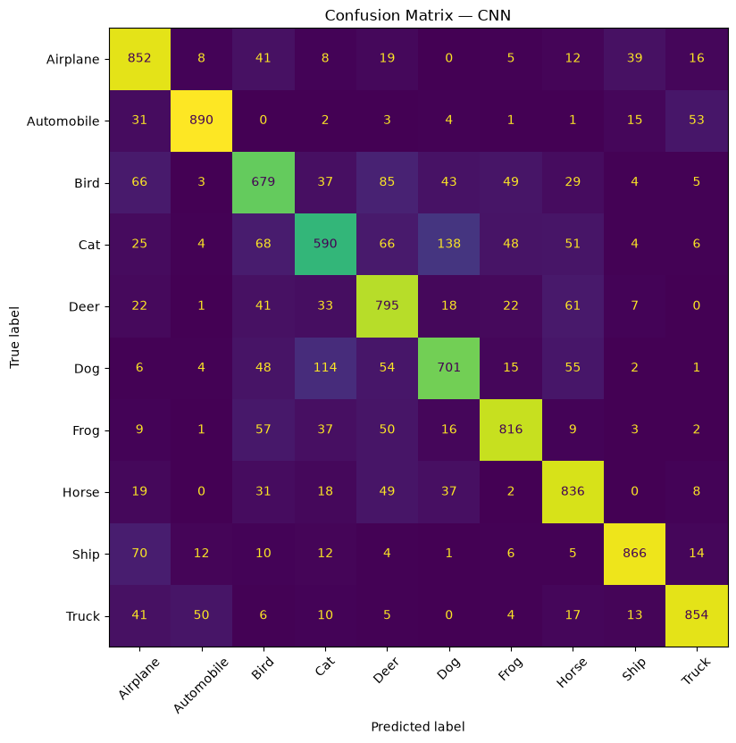

*Custom CNN (no augmentation) on the 10,000 test images. Rows are the true class, columns are the predicted class.*

</td>
<td align="center" width="50%">

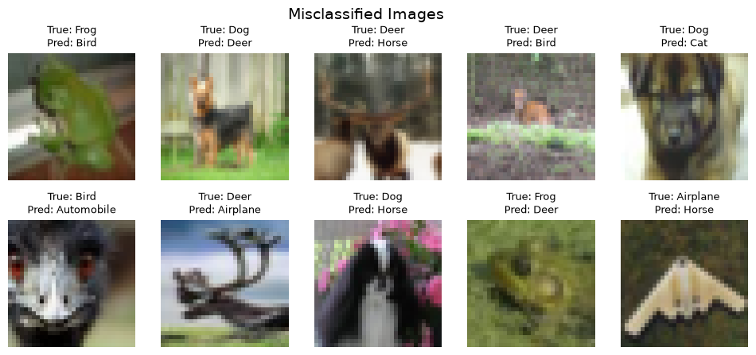

*Ten test images the CNN got wrong, with the true and predicted label.*

</td>
</tr>
</table>
</div>

**Most confused class pairs:** Cat ↔ Dog (**252** mistakes), Bird ↔ Deer (126) and Deer ↔ Horse (110).

<div align="center">

| Class | Correct (out of 1,000) | Most common wrong prediction |
|:---|:---:|:---|
| Automobile | 890 | Truck (53) |
| Ship | 866 | Airplane (70) |
| Truck | 854 | Automobile (50) |
| Airplane | 852 | Bird (41) |
| Horse | 836 | Deer (49) |
| Frog | 816 | Bird (57) |
| Deer | 795 | Horse (61) |
| Dog | 701 | Cat (114) |
| Bird | 679 | Deer (85) |
| **Cat** | **590** | **Dog (138)** |

</div>

Vehicles are the easiest classes and animals are the hardest. The cat is the weakest class, and its most common error is to be called a dog.

<br>

---

## 🔬 Key Experiments

### 🔄 Data Augmentation

<div align="center">

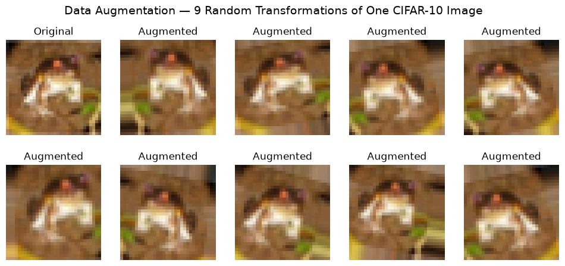

*One CIFAR-10 image and nine random transformations of it (rotation, shifts, zoom and flip). The label stays the same.*

</div>

| Method | Settings | Test accuracy | Train–val gap |
|:---|:---|:---:|:---:|
| None | — | 0.7879 | 0.118 |
| `ImageDataGenerator` | rotation 15°, shifts 10%, zoom 10%, horizontal flip | **0.8284** | **0.041** |
| Keras layers | `RandomFlip`, `RandomRotation(0.1)`, `RandomZoom(0.1)`, `RandomTranslation(0.1, 0.1)` | 0.7843 | — |

<div align="center">

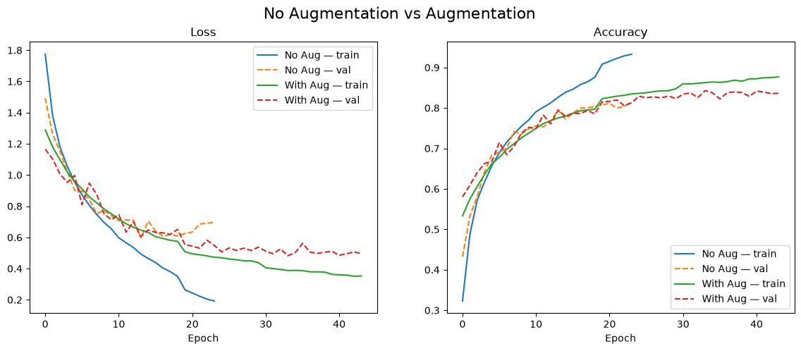

*Validation loss kept improving for much longer with augmentation, while the model without it began to overfit after about 14 epochs.*

</div>

**Reading the result honestly**
- Both methods use the same ideas, but `RandomRotation(0.1)` turns an image by up to ±36° (0.1 of a full turn), against ±15° in `ImageDataGenerator`. Stronger changes on tiny 32 × 32 images are a likely reason the Keras layers model did not improve — this was **not tested**.
- Each model was trained once, so a 0.36-point difference between the Keras layers model and the no-augmentation model is not conclusive.

### 🚀 Transfer Learning with MobileNetV2

<div align="center">

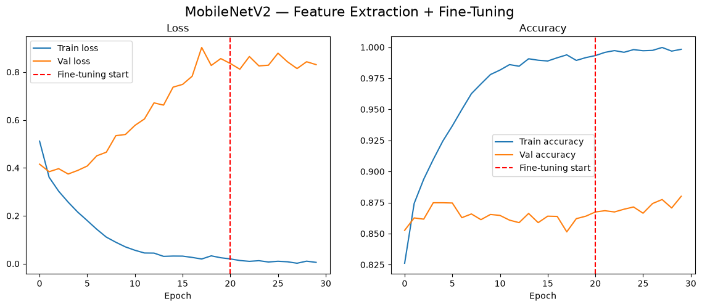

*The red line marks where fine-tuning starts (after 20 epochs of feature extraction).*

</div>

| Stage | Trainable parameters | Learning rate | Epochs | Test accuracy |
|:---|:---:|:---:|:---:|:---:|
| Feature extraction (base frozen) | 165,258 | 1e-3 | 20 | 0.8530 |
| Fine-tuning (last 30 base layers unfrozen) | 1,691,658 | 1e-5 | 10 | **0.8726** |

**Reading the plot honestly**
- During feature extraction, train accuracy climbed from 0.83 to 0.99, while the validation loss was lowest (0.374) at epoch 4 and then rose to about 0.9. The new head **overfits**, and validation accuracy stayed between about 0.85 and 0.875.
- No EarlyStopping was used for the two transfer-learning runs, so the feature-extraction score (0.8530) comes from the last-epoch weights.
- Fine-tuning lifted validation accuracy from about 0.867 to 0.880 and test accuracy by 1.96 points, but train accuracy was already close to 100%, so the validation loss did not improve.

### 🔗 Residual Connection
A small residual block (a 1 × 1 shortcut convolution plus two 3 × 3 convolutions with 64 filters, joined by `Add`) has **38,976** parameters. The shortcut gives the gradient a direct path, which helps very deep networks train.

<br>

---

## 🏆 Which Model Should We Use?

<div align="center">

<table>
<tr>
<td align="center" width="25%">

### 🔲 LeNet-5
**Smallest, weakest**
<br><br>
54.8% accuracy; train accuracy 0.744 against 0.554 on validation.
<br><br>
**For learning, not production**

</td>
<td align="center" width="25%">

### 🔄 CNN + Augmentation
**Best from scratch**
<br><br>
82.8% accuracy with 175K parameters and ≈ 17 s per epoch.
<br><br>
**Best small model**

</td>
<td align="center" width="25%">

### 🧊 MobileNetV2 Frozen
**Strong, quickly**
<br><br>
85.3% accuracy with only 165K trainable parameters, but the head overfits.
<br><br>
**Good starting point**

</td>
<td align="center" width="25%">

### 🔥 MobileNetV2 Fine-Tuned
**Most accurate**
<br><br>
87.3% accuracy, 2.4M parameters, ≈ 64 s per epoch.
<br><br>
**Recommended for accuracy**

</td>
</tr>
</table>

</div>

**Recommendation:** use the **fine-tuned MobileNetV2** when accuracy is the priority — it scored best on the test set. If model size or speed matters (for example on a small device), the **CNN with ImageDataGenerator** reaches 82.8% with about 14× fewer parameters.

**Limitations (observations only):**
- Single training run per model, so small differences (for example the Keras layers model vs the no-augmentation model) are not conclusive.
- CIFAR-10 images are only 32 × 32; for MobileNetV2 they were enlarged to 96 × 96, so the extra pixels carry no new detail.
- The validation set is the last 10% of the training data, not a shuffled or stratified sample.
- Only accuracy and the confusion matrix were analysed — no precision, recall or ROC curves.

<br>

---

## 🧪 What This Project Covers (Theory)

<details>
<summary><b>📖 Click to expand — Deep Learning Concepts Covered</b></summary>
<br>

- Why an ANN that flattens an image loses pixel position, and why a CNN needs far fewer parameters
- Why pixel values are normalised to 0–1 and labels are one-hot encoded
- Why the validation set is cut from the training data and the test set is kept for the end
- The convolution operation, filters (kernels) and weight sharing
- How to count the parameters of a convolution layer by hand
- VALID vs SAME padding, and how stride changes the output size
- Feature maps, MaxPooling vs AveragePooling, and the Flatten layer
- LeNet-5 and why a custom CNN with ReLU and GlobalAveragePooling does better
- Overfitting, and how EarlyStopping and ReduceLROnPlateau control it
- How to read training curves and a confusion matrix
- Data augmentation with `ImageDataGenerator` and with Keras layers
- Transfer learning: feature extraction vs fine-tuning, and why fine-tuning uses a very small learning rate
- Residual (skip) connections and why they help deep networks

</details>

<br>

---

## 📁 Repository Structure

```
deep-learning-pr4/
│
├── 📓 DL_PR4.ipynb               ← Full notebook — data to final comparison
├── 📊 plots/                     ← All saved figures
│   ├── sample_grid.png
│   ├── pixel_hist_before.png
│   ├── pixel_hist_after.png
│   ├── manual_convolution.png
│   ├── zero_padding.png
│   ├── feature_maps.png
│   ├── feature_maps_maxpool.png
│   ├── feature_maps_avgpool.png
│   ├── training_curves.png
│   ├── confusion_matrix.png
│   ├── misclassified.png
│   ├── augmentation_grid.png
│   ├── augmentation_comparison.png
│   └── finetuning_curves.png
├── 🧠 cnn_cifar10.h5             ← Saved custom CNN (no augmentation)
├── 📋 results_table.csv          ← Final comparison of all six models
├── 📋 requirements.txt           ← Library list
└── 📖 README.md                  ← This file
```

*Note: the `cifar-10-batches-py/` folder must be downloaded from the CIFAR-10 website and placed next to the notebook before running it.*

<br>

---

## 📦 Requirements

```
tensorflow
tf_keras
scikit-learn
pandas
numpy
matplotlib
scipy
jinja2
```

<br>

---

## 🛠️ Tools Used

| Tool | Used For |
|:---|:---|
| Python 3 / Jupyter Notebook | Development environment |
| TensorFlow 2.x / `tf_keras` | Conv2D, pooling, LeNet-5, custom CNN, augmentation, MobileNetV2, training and callbacks |
| scikit-learn | Confusion matrix |
| SciPy / NumPy | Manual convolution, padding, array handling |
| pandas | Results table |
| Matplotlib | All plots |

<br>

---

## 👨‍💻 Author

<div align="center">

### **Ayush Isamaliya**
*Data Science & Aspiring ML Engineer*

</div>

### 🌐 Connect With Me

<div align="center">

[](https://github.com/isamaliya16)
[](https://www.linkedin.com/in/ayush-isamaliya-686533312/)

</div>

<br>

<div align="center">


**Built as part of the Deep Learning track at Red & White Skill Education**


*Made with ❤️ | Deep Learning PR-4 | CNN from Scratch + Augmentation + Transfer Learning | CIFAR-10*

</div>
